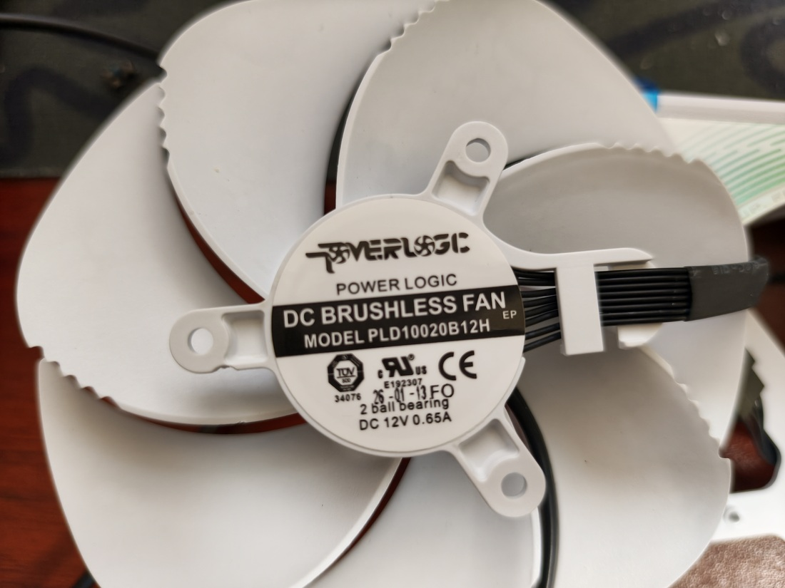
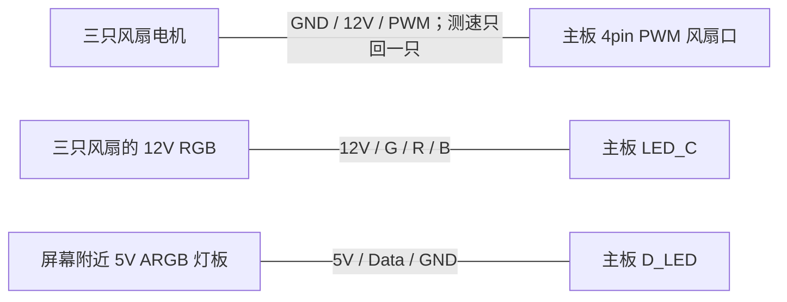
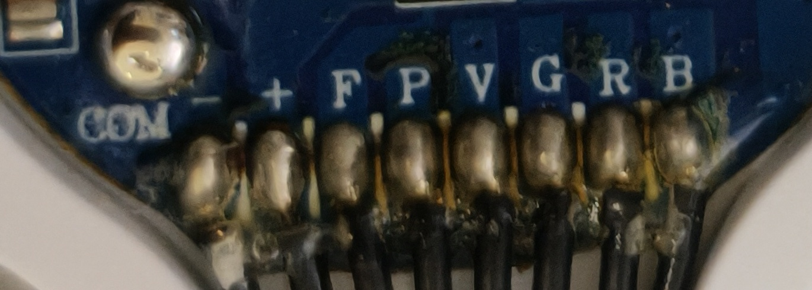
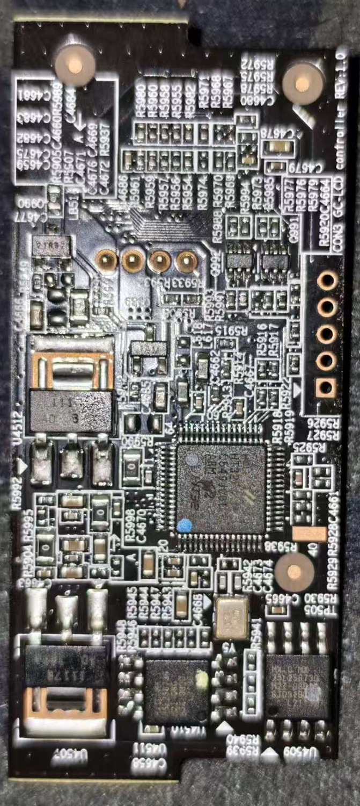
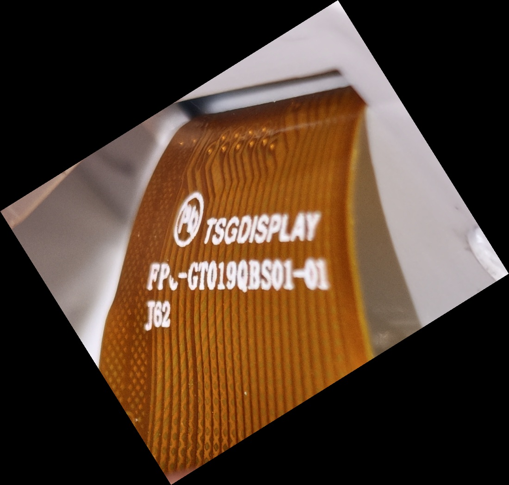
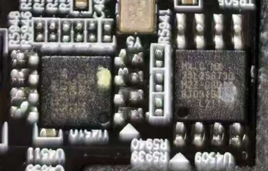

# 技嘉 RTX 5090 白色超级雕：原装风扇与灯光转接主板

更新日期：2026-10-26。

本文记录 AORUS RTX 5090 MASTER ICE 原装风扇、RGB 灯光和屏幕灯板的型号，以及改线接入电脑主板供电和控制的方法。风扇和灯光的接口类型来自实物确认，主板针表来自对应官方手册；整套改装的主板联动、电流与 PWM 曲线尚未完成测试记录。

## 1. 硬件型号

| 部件 | 型号 / 标记 | 接口与功能 |
| --- | --- | --- |
| 显卡 | **GIGABYTE AORUS GeForce RTX 5090 MASTER ICE**，GV-N5090AORUSM-ICE-32GD | 白色超级雕，本项目拆解对象 |
| 主板 | **B650M AORUS ELITE AX ICE** | 以下针表按中文 1102 手册整理 |
| 风扇 | **POWER LOGIC PLD10020B12H**，DC 12V 0.65A，双滚珠 | 每只两组 4pin：电机控制、12V RGB |
| 风扇电机 | − / + / F / P | 普通四线风扇：GND、12V、测速、PWM |
| 风扇灯光 | V / G / R / B | **12V 四线普通 RGB**，公共正极 |
| 屏幕附近独立灯板 | 完整料号未记录 | **5V 三线 ARGB**：5V、Data、GND |
| 原屏控制板主控 | **HOLTEK HT32F12345**，64 脚封装 | 社区资料显示经 I²C 接收命令与内容，再驱动裸屏 |
| 原屏 | 约 1.9 英寸 IPS、30pin；背面标记 **ST0190BS01** | 完整型号与原厂针表未确认 |
| 原屏 FPC | **TSGDISPLAY / FPC-GT019QBS01-01 / J62** | 照片识读；不据此确定显示控制器型号 |



## 2. 主板接线总览



三条支路分别控制：**风扇口负责转速，LED_C 负责风扇 RGB 颜色，D_LED 负责独立灯板 ARGB 灯效。** 原屏 LCD 的控制另见第 6 节。

### 原来的两组 12pin 怎样处理

每只风扇有两组 4pin；原三合一线束把三只风扇汇总成**两组 12pin**：一组用于电机，另一组用于 RGB。导通测量得到的逻辑分组是：

```text
电机 12pin：风扇 A 的 1 2 3 4 | 风扇 B 的 1 2 3 4 | 风扇 C 的 1 2 3 4
RGB  12pin：风扇 A 的 1 2 3 4 | 风扇 B 的 1 2 3 4 | 风扇 C 的 1 2 3 4
```

可拆掉汇总端的原 12pin 插头，保留风扇端线束，按下面的功能表改成标准主板插头。上面的数字只表示三个四线分组，**不是双排插头的正式孔位编号**；外插头的插合面与线色尚未建图，改线以实际导通关系和风扇焊盘丝印为准。



照片转正、焊线朝下，从左到右为：

```text
电机：−  +  F  P       灯光：V  G  R  B
```

## 3. 风扇电机：12V 供电、PWM 控速、F 测速

### 单只风扇接线

使用**标准电脑风扇 4pin PWM 插头尾线**。以下是电气针号，实际方向以插头导向槽及主板手册为准。

| 风扇焊盘 / 原线功能 | 标准风扇接口针号 | 主板功能 |
| --- | --- | --- |
| **− / COM** | **1** | GND |
| **+** | **2** | +12V，风扇电机供电 |
| **F** | **3** | TACH / SENSE，转速反馈 |
| **P** | **4** | PWM，转速控制输入 |

本主板可使用 **SYS_FAN4_PUMP**，进入 BIOS 的 Smart Fan 设置，将该接口设为 **PWM 模式**，再设转速曲线。只接 − / + 已实测能转动；本项目尚未记录完整 PWM 调速与测速结果。

中文手册明确将 SYS_FAN4_PUMP 第 4 脚列为 PWM，而将 SYS_FAN1/2/3 第 4 脚写作“无作用”，后者是否为手册笔误尚未核实，本文不默认所有 SYS_FAN 口都相同。

### 三只共用一个控制口

普通 PWM 一分三的信号分配方式是：

| 主板端 | 分配方式 |
| --- | --- |
| 1：GND | 分至三只风扇的 − |
| 2：+12V | 分至三只风扇的 +，前提是总负载符合接口额度 |
| 3：测速 | **只接一只风扇的 F**；另外两只 F 单独绝缘 |
| 4：PWM | 分至三只风扇的 P |

不要把三路 F 全部并到同一个测速输入。三只共用 PWM 后，主板只读取其中一只的转速，三只实际转速也不一定完全一致。

**供电预算：**本主板单个风扇口标示上限为 **2A / 24W**。如果三只铭牌均为 0.65A，合计是 **1.95A / 23.4W**，尚未计入未知的启动峰值。普通一分三线不会增加供电额度，本文尚未验证三只由单口供电可长期稳定工作。

若实测需要更多余量，可分接多个已确认支持 PWM 的接口，或使用电脑电源供电的 PWM 集线器；后者由主板提供 PWM / 测速控制，电机电流由电脑电源承担，集线器应避免向主板 12V 脚反向供电。

## 4. 灯光：12V RGB 与 5V ARGB 分别连接

### 风扇四线 RGB → 主板 LED_C

风扇灯光已用 12V 可调电源测试，确认是 **12V 普通 RGB**。使用**主板 12V 四针 RGB 插头尾线 / 分线器**：

| 风扇灯光焊盘 | LED_C1 / LED_C2 针号 | 含义 |
| --- | --- | --- |
| **V** | **1：12V** | RGB 公共正极 |
| **G** | **2：G** | 绿色通道 |
| **R** | **3：R** | 红色通道 |
| **B** | **4：B** | 蓝色通道 |

三只灯光若同步显示，可将对应的 V、G、R、B 分别同名并接，再接一个 LED_C 接口。三只灯光的合计电流需符合该接口标示的 **2A / 12V**，实际灯光电流目前未记录。

这里 **G 是 Green，不是 GND**。这四根线没有独立的数字 Data，主板通过 G / R / B 三个通道调光。可用支持该主板的 GIGABYTE CONTROL CENTER / RGB Fusion 设置颜色与灯效。

### 独立三线 ARGB 灯板 → 主板 D_LED

屏幕旁的独立灯板已确认是 **5V 三线 ARGB**。使用**5V ARGB 三针、四位缺一针**的主板标准插头尾线：

| 灯板功能 | D_LED1 / D_LED2 针号 | 含义 |
| --- | --- | --- |
| **5V / VCC** | **1：5V** | 灯板供电 |
| **DIN / DI / Data 输入** | **2：Data** | 接收主板 ARGB 灯效数据 |
| 无 | **3：缺针位** | 插头防呆空位 |
| **GND** | **4：GND** | 电源及数据参考地 |

原灯板小插头的孔位不一定与主板插头相同，需按功能转接；若灯板区分 DIN 和 DOUT，主板 Data 接 **DIN**。本主板手册给 D_LED 标示 **5A / 5V**，不能据此推定多个接口的整板合计额度。

接好后，在主板灯光软件中设置数字灯带 / ARGB 灯效。**5V ARGB 接 D_LED，12V RGB 接 LED_C，二者不能互插。**

## 5. 线材与改线步骤

基本材料：标准电脑风扇 4pin PWM 尾线、12V 四针 RGB 尾线、5V ARGB 三针尾线，以及需要时的一分三线、热缩管和万用表。原显卡小插头的系列和间距尚未确认，本文不指定未经核对的替代连接器型号。

1. 断开电脑电源及原显卡线束，用导通档将原汇总线每根线对应到风扇端 − / + / F / P 和 V / G / R / B。
2. 按功能表退针改壳，或焊接标准尾线；每个接头单独绝缘，外层做应力固定。不要只凭线色接线。
3. 接主板前核对 12V、5V、地线与信号，确认供电正负之间无短路；RGB 的 G / R / B 不当作普通地线。
4. 先测试单只风扇、单路 RGB 和独立 ARGB，再依据电流测量扩展到三只；记录 PWM 调速、测速与灯效结果。

## 6. 原屏 LCD：型号与供电 / 数据现状



原屏板主控为 **HOLTEK HT32F12345**。裸屏背面标记为 **ST0190BS01**，排线可读 **TSGDISPLAY / FPC-GT019QBS01-01 / J62**，目前没有与之完整匹配的原厂规格书。裸屏约 1.9 英寸 IPS、30pin，不能据标记或尺寸直接认定显示控制器型号。



社区开源实现支持的控制链路是：

```text
电脑程序 → 工作显卡及驱动提供的 I²C 通道 → 原屏控制板 / HT32 → 裸屏
```

已测的部分 AORUS MASTER RTX 5090 使用 **7bit I²C 地址 0x61**，内容格式为 **320 × 170、RGB565**，可上传图片、文字与转换后的动画。该结论来自下方社区项目，本块白色屏板尚未独立复现。

**LCD 目前没有可直接照接的主板供电 / 数据针表。** 原屏四线插口的供电额定值和逐针定义还未核实；I²C 的 SDA / SCL 是优先查线方向。它不是主板 D_LED 的单线 ARGB 数据，也未证实是 USB 或 UART，不能直接套用这些接口接线。

脱离工作显卡使用原屏板，需要经确认的供电与接口、外部 I²C 主机，以及适配社区协议的软件。普通主板 ARGB / RGB 接口不能直接上传 LCD 图片，现有社区电脑端程序也不能仅靠接主板灯光口就识别这个屏幕。

### 两颗“128M Flash”



目前观察到两颗“128M Flash”，完整料号尚未核实。**若每颗为 128Mbit SPI NOR，则每颗 16MiB，两颗合计 32MiB。** HT32F12345 本身有 64KB Flash、16KB SRAM，外部大容量 Flash 很可能用于保存图片、动画与内置素材。

相关 5080 MASTER ICE 社区研究发现媒体写入涉及 SPI Flash 擦除和页编程，支持上述用途分析；但两颗各自分工还不能确定，不能直接断言一颗固件、一颗动画，或认定为双备份。

## 7. 参考资料与待补信息

- [技嘉 RTX 5090 MASTER ICE 官方产品页](https://www.gigabyte.com/Graphics-Card/GV-N5090AORUSM-ICE-32GD)：显卡型号与 LCD EDGE VIEW 功能。
- [B650M AORUS ELITE AX ICE 官方支持页](https://www.gigabyte.com/Motherboard/B650M-AORUS-ELITE-AX-ICE-rev-1x/support)；[中文 1102 手册](https://download.gigabyte.com/FileList/Manual/mb_manual_b650m-aorus-elite-ax-ice_1102_sc.pdf)：第 20–22 页风扇、RGB、ARGB 针表及额度。
- [HOLTEK HT32F12345 官方手册](https://www.holtek.com/webapi/116711/HT32F12345_Datasheet_v150.pdf)：原屏主控参数。
- [albancreton/aorus-master-linux](https://github.com/albancreton/aorus-master-linux)：5090 LCD 原始 Linux 控制实现，作者明确只验证过一块卡。
- [AorusLcd 协议文档](https://github.com/CodeTorchAI/AorusLcd/blob/main/docs/PROTOCOL.md)：I²C 控制和内容上传格式。
- [c-drew/gigabyte-aorus-lcd-linux](https://github.com/c-drew/gigabyte-aorus-lcd-linux)：后续 Linux 实现，与前述项目存在继承关系。
- [AORUS LCD 固件研究](https://github.com/EKYavsil/aorus-lcd-panel-reverse-engineering)：指定 5080 MASTER ICE / LCD 1.4 的 Flash 操作研究，其补丁不能直接用于本块 5090。

后续重点补齐：两个 12pin 的插合面逐孔图、各路电流与主板联动结果、原屏四线接口针表，以及两颗 Flash 的完整料号与网络关系。

本文配图放在 `assets/`，采用相对路径，发布时与 README 一起上传。照片只做裁切、旋转、缩放和重新编码，没有补绘芯片字符；社区研究与工具归属于上述作者，本目录未附厂家固件或第三方代码。
